<samp>INSERT COIN • PRESS START • BUILD SOMETHING GREAT</samp>

---

## 🕹️ ARCADE MODE // CONTRIBUTION INVADERS

<samp>INCOMING WAVE: YOUR CONTRIBUTION HISTORY</samp>

<picture>
  <source media="(prefers-color-scheme: dark)" srcset="https://raw.githubusercontent.com/Ramdani101/Ramdani101/output/galaga-contribution-graph-dark.svg" />
  <source media="(prefers-color-scheme: light)" srcset="https://raw.githubusercontent.com/Ramdani101/Ramdani101/output/galaga-contribution-graph.svg" />
  
</picture>

<samp>EVERY DOT IS A DAY. EVERY COMMIT IS AMMO. KEEP SHOOTING.</samp>

> This isn't a random game animation. The arcade board is generated from my real GitHub contribution calendar: my coding activity becomes the game itself. The animation is regenerated automatically every day.

---

## 👾 PLAYER PROFILE

Hey there! I'm **Ramdani**, an Informatics Engineering student at **Universitas Negeri Surabaya (UNESA)**.

I enjoy turning ideas into practical software, exploring how technology works, and learning by building things. My interests include full-stack development, artificial intelligence, and solving problems through code.

- 🎓 Studying Informatics Engineering at UNESA
- 💻 Interested in full-stack development and software engineering
- 🧠 Exploring AI, machine learning, and problem solving
- 🌱 Always learning, experimenting, and building

---

## ⚡ INVENTORY // TECH STACK

---

## 📟 PLAYER STATS // HIGH SCORE

---

## 📡 CONNECT // PLAYER 2 WANTED

 

<samp>THANKS FOR PLAYING!</samp>

